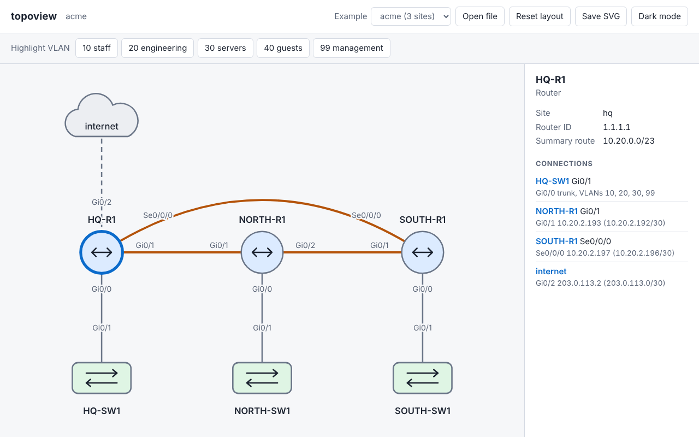

# topoview

[](https://github.com/rezarg-dev/topoview/actions/workflows/ci.yml)


An interactive network diagram for the browser. It reads a JSON description
of routers, switches and the links between them and draws it as a diagram
you can explore: select a device to see its addresses and connections,
highlight where a VLAN lives, drag things around, save the result as SVG.

**[Live demo](https://rezarg-dev.github.io/topoview/)**



Plain HTML, CSS and JavaScript modules. No framework, no build step, no
runtime dependencies: the files in this repository are the files the browser
loads.

## What it does

- **Draws a topology** from a file. Routers in a row, each switch below its
  router, the provider above the edge router. The same file always produces
  the same picture.
- **Details panel.** Selecting a device shows its site, router id, summary
  route or management address, its VLANs with their subnets, and every
  connection with interface names and addresses. Clicking a neighbour in the
  panel jumps to it.
- **VLAN highlighting.** One button per VLAN. Pressing it fades everything
  except the switches that have the VLAN, the trunks that carry it and the
  routers behind those trunks.
- **Drag to rearrange.** Links and port labels follow. A link that would
  run through another device bends around it.
- **Your own data.** Open a JSON file with the button or drop it on the
  page. A broken file does not replace the current diagram; the problems are
  listed instead.
- **Save as SVG.** The exported file carries its own styles and looks the
  same in an image viewer or a document.
- **Light and dark theme**, following the system setting until you choose.

The input is the `topology.json` that
[subnetplan](https://github.com/rezarg-dev/subnetplan) generates, and the
format is documented in [docs/data-format.md](docs/data-format.md).

## Run it

```bash
git clone https://github.com/rezarg-dev/topoview.git
cd topoview
node scripts/serve.js
```

Then open <http://localhost:8000>.

A server is needed because browsers do not load JavaScript modules from
`file://` URLs. Any static file server works; `scripts/serve.js` is a
small one so that nothing has to be installed.

To publish it, serve the repository root from any static host. On GitHub:
*Settings* → *Pages* → *Deploy from a branch* → `main`, `/ (root)`.

## Keyboard and accessibility

The diagram is usable without a mouse.

| Key | Action |
| --- | --- |
| `Tab` / `Shift+Tab` | Move between devices and controls |
| `Enter` or `Space` | Select or deselect the focused device |
| Arrow keys | Move the focused device by 10 units (`Shift`: 40) |
| `Escape` | Clear the selection |

- Every device is a focusable button with a name (`router HQ-R1`), and
  selection is exposed through `aria-pressed`.
- The details panel is a live region, so a screen reader announces the
  device that was selected.
- Device types differ by shape and by a glyph inside the shape, not by
  colour alone. Link types differ by width and dash pattern.
- Errors are announced through `role="alert"`.
- Focus is always visible.

## How it is built

```
index.html          the page
css/style.css       all styles; colours are custom properties, themes swap them
js/
  topology.js       validating a file and querying it (VLANs, links of a node)
  layout.js         initial positions
  geometry.js       the shape of a link, including bending around nodes
  details.js        what the details panel shows for a node
  render.js         builds the SVG and keeps it in sync with positions
  export.js         standalone SVG
  app.js            state and event handling
data/               example topologies
scripts/serve.js    static file server for development
tests/              node:test
```

Some decisions:

**Logic is kept out of the DOM.** `topology.js`, `layout.js`, `geometry.js`
and `details.js` take plain data and return plain data. They import nothing
from the browser, which is why they can be tested with `node --test` and no
browser or DOM emulation. `render.js` and `app.js` are the only files that
touch the document, and they contain as little logic as possible.

**A layered layout instead of a force simulation.** The networks this is
made for have a known shape: sites with a router and a switch. Putting each
kind of device on its own row shows that shape immediately, costs a few
lines, and is deterministic. A physics simulation would give a different
picture on every load and need a library.

**Loaded files are treated as untrusted.** Everything from a file reaches
the page through `textContent` or SVG attributes, never as HTML, so a
crafted file cannot inject markup or script. Files are validated completely
before anything on screen changes.

**SVG, not canvas.** Each device is a real element that can take focus,
carry a label for assistive technology, and be styled with CSS. With a
canvas all of that would have to be rebuilt by hand.

**One stylesheet, themed with custom properties.** The diagram reads its
colours from variables on `:root`. That also makes the SVG export simple: in
a standalone SVG file `:root` is the `<svg>` element, so copying the rules
into the file is enough for them to apply there.

## Tests

```bash
npm test
```

The tests cover validation (every problem in a broken file is reported with
its position), VLAN queries, the layout, link geometry and the content of
the details panel. They also check that every file in `data/` is valid and
that the example selector in `index.html` offers exactly those files.

There are no automated browser tests in the repository. Rendering and
interaction (selecting, dragging, keyboard control, themes, opening and
exporting files) were checked in Chromium, outside this test suite.

## Limitations

- **The layout is made for site-shaped networks.** Routers, one or a few
  switches behind each, one cloud. A full mesh of twenty routers will be
  readable only after rearranging it.
- **Positions are not saved.** Reloading the page restores the automatic
  layout.
- **No zoom or pan.** The diagram scales to fit the window.
- **View only.** The topology cannot be edited in the page.

## License

[MIT](LICENSE)
